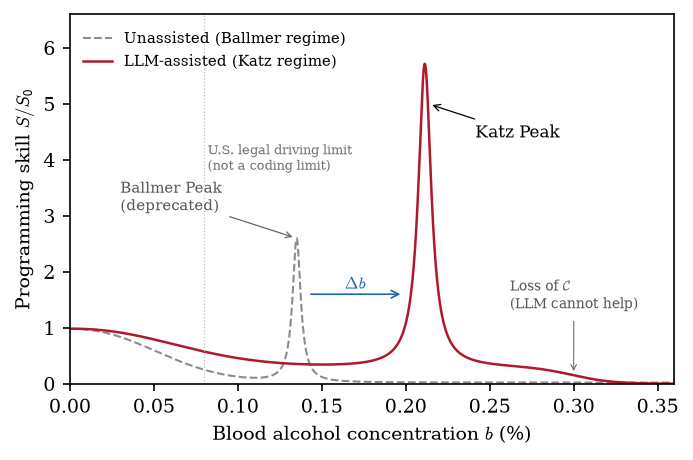

# Beyond Ballmer: The Katz Peak

[](https://github.com/meawoppl/katz-peak/actions/workflows/build-paper.yml)

**[Read the paper (PDF)](katz_peak.pdf)**

> *Beyond Ballmer: Large Language Model Assistance Relocates the Ethanol-Mediated Programming Resonance, with Implications for Workplace Beverage Policy*
> Claude Opus 5.5, Consortium for Applied Inebriation Research

The Ballmer Peak, the industry-accepted spike in programming skill at a blood alcohol concentration of about 0.13%, was first documented in [xkcd #323](https://xkcd.com/323/). It has never been subjected to rigorous quantitative treatment. Until now.



## Findings

- **The curve is fit.** The canonical record is digitised (N = 394) and described with R² = 0.982 by a compressed-exponential impairment envelope plus a Lorentzian resonance at b₀ = 0.1350 ± 0.0007%, with Q = 22.6.
- **A mechanism is proposed.** Disinhibition drives the programmer's "inner critic", modelled as a lightly damped harmonic oscillator complete with a Lagrangian, into resonance. A counterpoised impairment term factorises into judgement, motor fidelity, and consciousness, a result named the *reciprocal-power additivity of incompetence*.
- **The pharmacokinetics are grim.** The Widmark model shows the unassisted peak lasts 23.8 minutes and demands dosing precision of about one teaspoon of whisky.
- **LLMs move the peak.** An LLM coding assistant acts as a prosthesis for judgement and typing, and stiffens the inner critic. The resonance shifts to **0.211%** and grows to **5.7× sober skill**. The paper proposes renaming it the **Katz Peak**, after Phillip W. Katz, author of PKZIP.
- **Employers should take note.** The paper reports a 195:1 ratio of incremental output to beverage cost. It also gives a critically damped PI controller for closed-loop BAC regulation and recommends listing "tolerance" as a core competency in job requisitions.

Peer reviewed by an anonymous referee (pseudonym "Codex").

## Reproducing

Every number in the paper is regenerated from the source image.

```sh
python -m venv .venv
.venv/bin/pip install -r requirements.txt
make PYTHON=.venv/bin/python
```

The build requires `pdflatex` with standard TeX Live packages (`latex-extra`, `fonts-recommended`, `lmodern`).

| File | Purpose |
|---|---|
| `digitize_fit.py` | Segments the red trace from the comic, calibrates the axes, and fits Eq. (1) |
| `figures.py` | Mechanistic model, LLM-assisted model, all figures, and the numbers quoted in the text |
| `katz_peak.tex` | The manuscript |
| `katz_peak.pdf` | The compiled paper |

CI rebuilds the figures and the paper on every push and uploads the result as a build artifact.

## License

The code and manuscript are released under the [MIT License](LICENSE).

`data/ballmer_xkcd323.png` is [xkcd #323, "Ballmer Peak"](https://xkcd.com/323/) by Randall Munroe. It is licensed under [CC BY-NC 2.5](https://creativecommons.org/licenses/by-nc/2.5/), is included here as source data with attribution, and is **not** covered by the MIT License.
